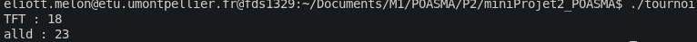
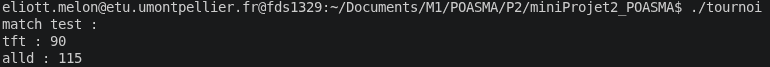
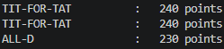
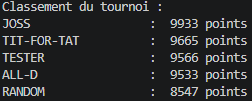
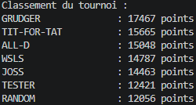
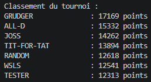
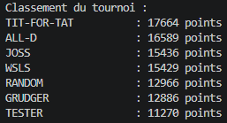
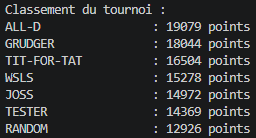

# Journal de bord : tournoi du dilemme du prisonnier itéré

Sommaire :
1. Protocole
2. Stratégies
3. Étape 1 : le tournoi de base
4. Étape 2 : nouvelles stratégies
5. Étape 3 : modifier le tournoi
6. Impasses
7. Utilisation de l'IA

---

## 1. Protocole

### Choix généraux (13/11)

- language : C++, language nécessaire au master imagine donc ca m'entraine

- Format du tournoi : chaque programme affronte chaque autre sur 5 parties de 200 tours ; le gagnant a le meilleur score total (CM page 63)

- Matrice de gain : (C,C) = 3,3 · (C,D) = 0,5 · (D,C) = 5,0 · (D,D) = 2,2

- Gains :
  - Les préférences de i : D,C ≻ᵢ C,C ≻ᵢ D,D ≻ᵢ C,D
  - Les noms des issues : 5 : la tentation · 3 : la récompense · 2 : la punition · 0 : le gain du pigeon

- regles :
  - une strategie peut jouer contre elle meme si ce n'est pas le meme "joueur"
  - chaque programme connait les coups passés de l'adversaire
  - Score : somme des scores contre chaque adversaire

- Graine aléatoire : std::mt19937 rng(2052004); (valeur arbitraire)

### Modèle de population (14/11)

- Modèle de population : une case de la population = un JOUEUR (comme dans le mini-tournoi du CM page 68 : TFT1, TFT2, ALL-D).
  - un joueur ne joue jamais contre lui-même : chaque paire de joueurs différents joue un match (boucle j = i + 1)
  - pour faire jouer une stratégie contre elle-même, on met deux joueurs de cette stratégie dans la population (ex : TFT1 contre TFT2)
  - ce modèle pourrait servir pour la sélection (étape 3, pas retenue), où le nombre de joueurs de chaque stratégie varie

- Stratégies sans état interne : JOSS et TESTER décident uniquement à partir de mesCoups / coupsAdverses
  (mesCoups.size() donne le numéro du tour), donc pas besoin de reset() et un même objet peut servir à plusieurs joueurs sans risque.

- Différence avec Axelrod 1980 : avec un joueur par stratégie, il n'y a pas de match entre "jumeaux" (Axelrod en faisait un).
  À prendre en compte pour répondre à la question "TFT gagne-t-il ?".

### Récapitulatif des paramètres

| Tournoi | Population | Parties | Tours | Bruit | w |
|---|---|---|---|---|---|
| diapo (validation) | TFT, TFT, ALL-D | 1 | 10 | 0 | - |
| etape1 | 5 stratégies du cours | 5 | 200 | 0 | - |
| etape2 | 7 stratégies | 5 | 200 | 0 | - |
| bruit | 7 stratégies | 5 | 200 | 0,05 | - |
| horizon | 7 stratégies | 5 | 200 en moyenne | 0 | 0,995 |
| combine (bonus) | 7 stratégies | 5 | 200 en moyenne | 0,05 | 0,995 |

bruit : 5% valeur proposée par le sujet et assez fort pour le voir apparaitre et assez faible pour que ce ne denaturalise pas toutes les strategies

horizon : 0.995 semblable en moyenne a l'etape 2 (200 tours) mais la duree varie, observee entre 2 et 1106 tours

---

## 2. Stratégies

### Stratégies du cours

- ALL-D :  toujours D : la stratégie "rationnelle" de la récurrence à rebours
- RANDOM :  C ou D au hasard, une chance sur deux : sert de témoin
- TIT-FOR-TAT : C au premier tour, puis rejouer le coup de l'adversaire au tour précédent
- TESTER : D au premier tour. Si l'adversaire à riposté au tour 1, joue TIT-FOR-TAT à partir du tour 2 ; sinon répète C, C, D a partir du tour 2 (interpretation du cm page 64)
- JOSS : TIT-FOR-TAT, mais remplace C par D une fois sur dix de facon deterministe

Contre qui elles devraient bien ou mal jouer :

- ALL-D : bien contre RANDOM (il l'exploite), mal contre ceux qui ripostent (D/D tout le match).
- RANDOM : mal contre tout le monde, ne construit jamais de coopération.
- TIT-FOR-TAT : bien contre les coopératifs (C/C), mal contre ALL-D. Ne gagne jamais un duel.
- TESTER : bien contre ceux qui ne ripostent pas, mal contre ceux qui punissent (GRUDGER, JOSS).
  - choix : la riposte n'est vérifiée qu'au tour 1.
- JOSS : bien contre ceux qui pardonnent (TFT), mal contre les rancuniers (GRUDGER).
  - choix : trahit aux tours 10, 20, 30... au lieu de 10 % au hasard.

### Nouvelles stratégies (étape 2)

- WSLS : en cherchant sur internet des strategies je suis tombé sur la strategie Pavlov ou Win stay Lose shift qui se base sur le resultat de son tour precedent si il ets positif il reste et si il est negatif il change.

- Grudger : globalement un TFT plus severe, a partir du moment ou il se fait trahir une fois il il ne coopere plus.

Contre qui elles devraient bien ou mal jouer :

- Grudger :
  - bien contre les gentils (TFT, WSLS) : personne ne trahit en premier donc C/C tout le match
  - bien contre ceux qui trahissent souvent (TESTER, RANDOM) : il les punit pour toujours des la premiere trahison, eux continuent a jouer C de temps en temps.
  - moyen contre JOSS : la trahison surprise du tour 10 declenche la rancune, donc D/D jusqu'a la fin, aucun des deux ne marque beaucoup.
  - mal contre ALL-D : se fait avoir au tour 1 puis D/D, comme TFT.
  - point faible : ne pardonne jamais, donc une seule erreur comme le bruit de l'etape 3 suffit a casser une cooperation pour tout le reste du match.
- WSLS :
  - bien contre les gentils (TFT, GRUDGER) : C/C c'est gagne donc il reste sur C.
  - mal contre ALL-D : apres D/D (perdu) il repasse a C, se fait trahir (perdu) donc repasse a D, et ainsi de suite → il joue le pigeon un tour sur deux.
  - mal contre RANDOM et JOSS : il change de coup a chaque resultat negatif donc il suit les trahisons au lieu de les punir durablement.
  - point fort : se remet tout seul d'une erreur (apres D/D il revient a C), contrairement a TFT qui peut rester bloque dans un echo de represailles → devrait etre bon avec du bruit.
  - choix : la tentation (5) compte comme un resultat "gagne", donc "gagne" <=> l'adversaire a joue C au tour precedent.

---

## 3. Étape 1 : le tournoi de base

### Moteur et tests (14/11)

Premiers tests de `partie()` et `match()` (TFT contre ALL-D) :

Test de validation : population {TFT, TFT, ALL-D}, 1 partie de 10 tours → on doit retrouver TFT1 = 48, TFT2 = 48, ALL-D = 46 (CM page 68).

Sur la capture, le test a été lancé avec 5 parties de 10 tours : 240 / 240 / 230 = 5 × (48 / 48 / 46), donc le moteur est validé.
La commande `tournoi.exe diapo` lance maintenant exactement le format de la diapo (1 partie de 10 tours) et donne 48 / 48 / 46.

### Tournoi d'Axelrod (15/11)

Commande : `tournoi.exe etape1`

Observations :

- TFT : n'affronte pas assez de strategies coopérative et ne peux donc pas farmer des points.
- AllD : se fait avoir par les strategies qui verifient si il joue D et qui ensuite l'empeche de marquer des points
- Joss : joue comme TFT, mais vole des points avec ses D surprises, gagne de peu grace a ca. Contre ALL-D il perd comme TFT.
- Random : dernier, perd beaucoup contre ALL-D (998 - 3503) et comme il joue au hasard il ne peut jamais construire une longue cooperation pour marquer des points. Il bat quand meme Tester.
- Tester : contre ALL-D il voit le D au tour 1 donc passe en TFT, ca donne D/D tout le temps donc égalité. Contre ceux qui jouent C au tour 1 (TFT, JOSS) il essaie d'exploiter avec C, C, D mais ils ripostent : egalite contre TFT et il perd contre JOSS.

### Question : TIT-FOR-TAT gagne-t-il ?

Non : TFT finit 2e, derrière JOSS. Il ne gagne aucun duel, il perd ou fait égalité contre tout le monde.

Pourquoi le résultat diffère de celui de 1980 :
- la population : 5 stratégies dont une seule gentille (TFT), contre 14 programmes (+ RANDOM) en 1980, dont beaucoup de gentils. TFT n'a personne avec qui coopérer.
- le match contre le "jumeau" : pas de TFT contre TFT ici (un joueur par stratégie). Ce match rapporterait 3000 à TFT (C/C tout le match) mais très peu à JOSS contre JOSS (D/D après le tour 10), ce qui devrait suffire à remettre TFT premier.
- JOSS déterministe : l'original trahit au hasard 10 % du temps, le mien trahit à des tours fixes, ce qui change ses duels.

---

## 4. Étape 2 : nouvelles stratégies

Commande : `tournoi.exe etape2`

### Comparaison avec l'étape 1

- qui monte, qui descend : GRUDGER arrive 1er, TFT reste 2e, JOSS chute de 1er à 5e, TESTER de 3e à 6e.
- pourquoi :
  - GRUDGER : C/C avec les gentils (3000 contre TFT et WSLS) et punit ceux qui trahissent (3985 - 685 contre TESTER, 3442 - 1057 contre RANDOM).
  - TFT : a enfin des partenaires coopératifs (3000 contre GRUDGER et WSLS), ce qui confirme l'analyse de l'étape 1.
  - JOSS : ses D surprises ne marchent plus contre GRUDGER (2050 - 2050, D/D après le tour 10).
  - TESTER : exploite GRUDGER avec C, C, D alors que GRUDGER joue D pour toujours (685 - 3985), car la riposte n'est vérifiée qu'au tour 1.
- par rapport à ce que j'avais prévu :
  - GRUDGER : tout est juste (bien contre les gentils, TESTER et RANDOM, moyen contre JOSS, mal contre ALL-D 1990 - 2015).
  - WSLS : juste contre les gentils, ALL-D (1000 - 3500) et JOSS (2230 - 2480), mais faux contre RANDOM, qu'il bat de peu (2562 - 2452).

---

## 5. Étape 3 : modifier le tournoi

### Choix des modifications

Modifications : Bruit et Horizon inconnu : les deux sont rapides a implementer et devraient être interessantes a observer
- le bruit teste si les strategies savent pardonner une erreur
- l'horizon inconnu teste l'argument de la recurrence a rebours du cours

### Prédictions (écrites avant de coder et de lancer, commit 9b83a02)

- Bruit (5 % : chaque coup est inverse avec une probabilite de 0,05) : devrait desavantager les strategies qui restent bloquées dans des boucles (Grudger, TFT, ...) et avantager WSLS
  - TFT contre TFT / GRUDGER : une erreur lance un echo de represailles C/D, D/C... jusqu'a la prochaine erreur
  - GRUDGER : une seule erreur de l'adversaire et il joue D pour toujours
  - WSLS : apres un D/D accidentel il revient a C tout seul

- Horizon (w = 0,995 : apres chaque tour la partie continue avec une probabilite de 0,995, donc 1 / (1 - w) = 200 tours en moyenne) :
  devrait avantager Random puisque les tours pourraient etre tres court et les strategies pourrait ne pas avoir le temps de farmer des points

### Modification 1 : bruit

Implémentation : dans `partie()`, après le choix des deux coups, chaque coup est inversé avec une probabilité de 5 %. Le coup inversé compte partout (gains et historiques). Le tirage n'est fait que si bruit > 0 pour garder les résultats de l'étape 2 sans bruit.

Commande : `tournoi.exe bruit`

Comparaison avec la prédiction :
- juste : TFT recule (2e → 4e), sa coopération avec GRUDGER casse (3000 - 3000 → 1989 - 2244).
- faux : WSLS ne profite pas du bruit, il chute (4e → 6e), et GRUDGER reste 1er.
- explication : après une erreur, GRUDGER joue D pour toujours. Contre quelqu'un qui joue toujours D, WSLS joue le pigeon un tour sur deux (GRUDGER - WSLS : 3393 - 1218). GRUDGER garde aussi ses gros scores contre TESTER (3843) et RANDOM (3386), qui trahissent de toute façon. ALL-D monte (3e → 2e) : le bruit casse les coopérations des autres, lui n'a rien à perdre.

### Modification 2 : horizon inconnu

Implémentation : dans `partie()`, la boucle `for` devient un `while` : après chaque tour, la partie continue avec une probabilité w. Durée mesurée : 201,7 tours en moyenne (min 2, max 1106). Le tirage n'est fait que si w > 0.

Commande : `tournoi.exe horizon`

Comparaison avec la prédiction :
- juste : il y a bien des parties tres courtes (2 tours minimum) ou personne n'a le temps de farmer.
- faux : RANDOM n'est pas avantagé, il reste 5e. Par contre le classement change beaucoup (TFT 1er, GRUDGER chute de 1er a 6e), ce que je n'avais pas prevu.
- explication : aucune stratégie ne compte les tours restants, donc leur comportement ne change pas. Seule la durée des duels change, et elle est tirée au hasard. Les écarts viennent surtout de la chance : TFT - RANDOM tombe sur des parties longues (4928 points) alors que GRUDGER - RANDOM tombe sur des parties courtes (1987), et TFT - GRUDGER coopèrent toujours mais ne font que 2079 au lieu de 3000 (693 tours au lieu de 1000). Il faudrait plus de parties par match pour que la chance s'équilibre.

### Bonus : bruit + horizon combinés

Commande : `tournoi.exe combine`

ALL-D finit 1er, mais surtout grâce à un duel tombé sur des parties longues contre RANDOM (7227 - 2492). GRUDGER est 2e : il écrase TESTER (4973 - 1168) et WSLS (4228 - 1563), comme avec le bruit seul.

### Conclusion de l'étape 3

- le bruit punit les coopérations fragiles : TFT s'enferme dans les représailles et GRUDGER ne pardonne jamais, mais GRUDGER reste 1er car il punit aussi ceux qui trahissent vraiment.
- WSLS ne profite pas du bruit dans cette population : il se fait exploiter par les rancuniers (GRUDGER) et par ALL-D.
- l'horizon inconnu ne change pas le comportement de mes stratégies (aucune n'utilise le dernier tour), il ajoute seulement de la chance sur la durée des duels. Du coup il ne permet pas vraiment de tester la recurrence a rebours : il faudrait une strategie qui trahit au dernier tour quand elle le connait.

---

## 6. Impasses

- Impasse : j'avais d'abord fait jouer chaque case contre elle-même (boucle j = i, en comptant le score une seule fois),
  en pensant qu'une case = une stratégie et que ce match représentait TFT1 contre TFT2.
  Problème : si on met deux TFT dans la population, le match TFT contre TFT est joué 3 fois au lieu d'une.
  Le CM (page 68) montre qu'un joueur ne joue pas contre lui-même (diagonale vide) → retour à j = i + 1.

- TESTER : d'abord `coupsAdverses[1]` (hors du tableau au tour 2), branches inversées, et cycle décalé (D aux tours 3, 6...) → `coupsAdverses[0]` et D quand `mesCoups.size() % 3 == 0`.
- WSLS : "gagné" était "mes deux derniers coups sont identiques", donc D/D comptait comme gagné et D/C comme perdu → "gagné" <=> l'adversaire a joué C.

---

## 7. Utilisation de l'IA

- Ce journal a été restructuré à l'aide de Claude (mise en forme et organisation des sections).
